# Poortmodule bedrading (v3)

Volledig schema voor de nieuwe print: voeding uit 12 V, ESP32-S3, Bus T4 naar beide Nice SNA20's, maglocks via MOSFET, reserve-P.P. via optocoupler, en gefilterde ingangen. Referenties (R1, C1, …) komen overeen met de onderdelenlijst.

*Klik op het schema om het groot te openen.*

**Kleuren van de draden**

| Kleur | Net |
|---|---|
| bruin | 230 V |
| rood | +12 V |
| oranje | 5,2 V |
| geel | 3V3 |
| grijs | GND |
| blauw | Bus T4 / UART |
| paars | uitgang / geschakeld |
| groen | ingang |
| turquoise | optocoupler-contact |

Een vlag (+12V, 3V3) of massateken betekent: verbonden met dat net, ook als er geen lijn getekend is. Alle massa's zijn één net, behalve de uitgang van de optocouplers: die blijft gescheiden van de ESP.
\* R1 en R2 alleen plaatsen als het MOSFET-bordje zelf geen pull-down heeft (meet PWM+ naar GND).

## Onderdelenlijst

| Ref | Onderdeel | Aantal |
|---|---|---|
| U1 | ESP32-S3 DevKitC-1 N16R8 | 1 |
| U2 | XY-2596 buck, afgeregeld op 5,2 V | 1 |
| U3, U4 | Seeed Grove RS485 (MAX13487E) | 2 |
| U5, U6 | PC817 optocoupler (DIP-4) | 2 |
| Q1, Q2 | MOSFET-module D4184 | 2 |
| PS1 | 12 V / 3 A voeding (ZSB-36W-1203) | 1 |
| F1 | Zekering 2 A traag + houder | 1 |
| D1 | 1N5819 Schottky | 1 |
| D2, D3 | 1N4007 (over de maglocks) | 2 |
| C1 | 470 µF / 25 V elco | 1 |
| C2 | 100 µF / 10 V elco | 1 |
| C3–C6 | folie/keramisch: C3, C4 100 nF · C5, C6 150 nF | 4 |
| R1, R2 | 10 kΩ (optioneel, zie \*) | 2 |
| R3, R4 | 330 Ω | 2 |
| R5–R8 | 3,3 kΩ pull-up | 4 |
| R9–R12 | 470 Ω serie | 4 |
| J1 | Klem 230 V (L, N, PE) | 1 |
| J2, J3 | Klem 3-polig (CANH, CANL, GND) of RJ-bus | 2 |
| J4–J7 | Klem 2-polig (maglocks, P.P.) | 4 |
| J8–J11 | Klem 2-polig (reeds, knoppen) | 4 |

## Pinnen ESP32-S3 (header J1)

| J1 | GPIO | Functie |
|---|---|---|
| 1, 2 | 3V3 | Grove VCC, pull-ups |
| 4 | 4 | TX poort 1 → RX U3 |
| 5 | 5 | RX poort 1 ← TX U3 |
| 6 | 6 | TX poort 2 → RX U4 |
| 7 | 7 | RX poort 2 ← TX U4 |
| 8 | 15 | Maglock poort 1 (Q1) |
| 9 | 16 | Maglock poort 2 (Q2) |
| 10 | 17 | P.P. poort 1 (U5) |
| 11 | 18 | P.P. poort 2 (U6) |
| 12–14 | 8, 3, 46 | vrij (3 en 46: strapping, niet gebruiken) |
| 15 | 9 | Reed poort 1 (dicht) |
| 16 | 10 | Reed poort 2 (vol open) |
| 17 | 11 | Drukknop 1 kant |
| 18 | 12 | Drukknop 2 kanten |
| 19, 20 | 13, 14 | vrij |
| 21 | 5V | van buck via D1 |
| 22 | GND | massa |

## Bouwnotities

- Regel U2 af op 5,2 V vóór je de ESP aansluit. D1 laat je veilig tegelijk via USB flashen.
- C3–C6 en R5–R8 zo dicht mogelijk bij de ESP; R9–R12 bij de connectoren. Samen vangen ze storing op lange kabels op. Contact dicht: ongeveer 0,4 V op de GPIO en 1 mA door het contact.
- D2/D3: de streep (kathode) naar +12 V. Verkeerd om = kortsluiting zodra de MOSFET schakelt.
- U5/U6: meet eerst de polariteit van P.P.–COM op de sturing. Collector (4) naar de pluskant.
- RJ pos 2 (+28 V) van de sturingen niet aansluiten; de ESP draait volledig op de 12 V-voeding.
- Leg CANH/CANL samen in één getwist paar van de UTP, met GND in een tweede paar.
- 230 V-kant in een gesloten behuizing, met de klemafdekking van PS1 erop.

## Status in de praktijk (16-10)

- GND naar RJ pos 5 ontbreekt nog op **poort 2** (J3). Steve takt hem af van de reed-GND aan de printkant.
- Maglocks (J4, J5) nog niet aangesloten. P.P. poort 1 en 2 (J6, J7) aangesloten en getest.

Bron: [`poortmodule-bedrading-v3.html`](poortmodule-bedrading-v3.html) (dezelfde inhoud, te openen in een browser).
